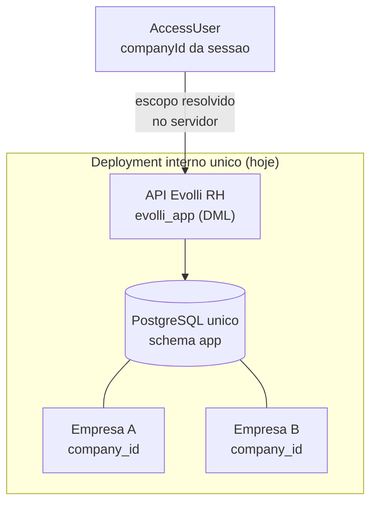
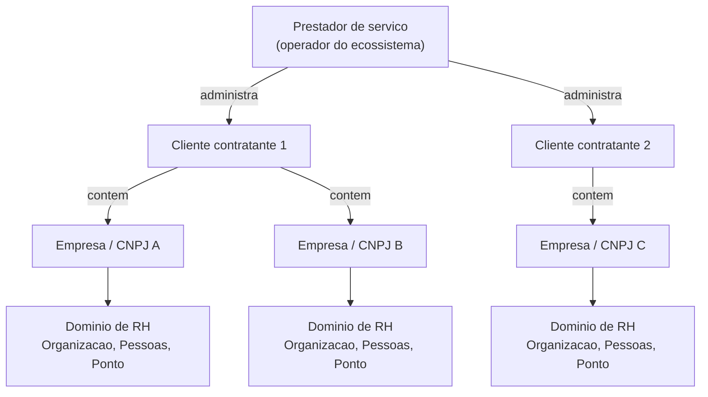
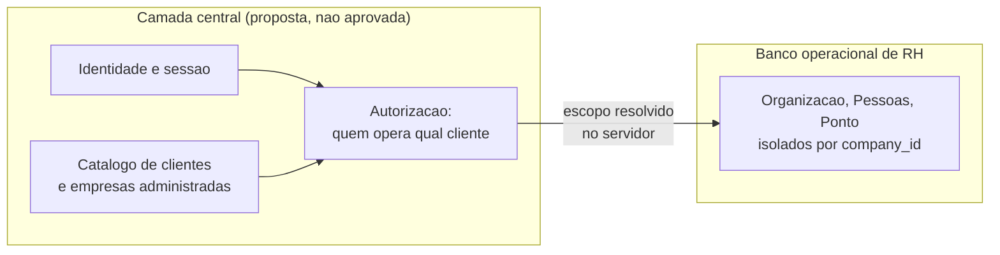
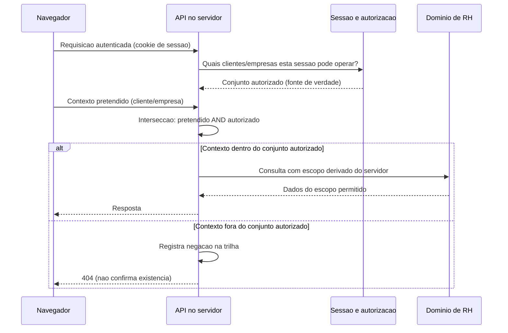

# Fatia transversal — evolução multiempresa preparada

> **Nota de convergência (T032; [ADR 0012](../adr/0012-convergencia-governanca-privacidade-e-perfis-globais.md), CG-RBAC-01).**
> Onde este documento descreve o `admin_tecnico` com **acesso global** ao
> ambiente interno (exceção da Emenda 1 da ADR 0005), leia-se como registro
> **histórico**: o `admin_tecnico` **convergiu para bootstrap/histórico** e não é
> mais perfil global operacional. O **único** acesso global permanente é o
> **`master_tecnico`** (ADR 0012, T030). Os textos abaixo são preservados como
> história — não reescritos.

- Status: **decisão aprovada** (2026-08-11) para a interpretação do gatilho
  e as restrições que a acompanham — fase **Registrar decisão aprovada**.
  Nenhuma fase Implementar foi aberta por esta atualização.
- Fase do SDD: Registrar decisão aprovada. Nenhum código, schema,
  migration, endpoint, dependência, infraestrutura, banco, bucket ou
  serviço externo é criado, alterado ou autorizado por este documento.
- Decisão correspondente: [rebaseline-multiempresa-pronto-pendente.md](../decisions/rebaseline-multiempresa-pronto-pendente.md)
  — **DECISÃO APROVADA**, formalizada na
  [ADR 0010 — Preparação Multiempresa Interna](../adr/0010-preparacao-multiempresa-interna.md).
- Relacionado: [README.md](../../README.md), [docs/ARCHITECTURE.md](../ARCHITECTURE.md),
  [docs/ROADMAP.md](../ROADMAP.md),
  [ADR 0003](../adr/0003-identidade-sessao-e-autorizacao.md),
  [ADR 0005](../adr/0005-escopo-interno-e-evolucao-multitenant.md),
  [ADR 0006](../adr/0006-modelo-organizacional-interno-baseline-v1.md),
  [ADR 0007](../adr/0007-colaboradores-e-vida-funcional-baseline-v1.md),
  [ADR 0008](../adr/0008-jornada-ponto-rastreavel-baseline-v1.md).

## 0. Estado verificado e observações registradas

Esta seção separa **o que foi verificado no repositório** do que é
recomendação ou pendência. Nada aqui é decisão de produto.

### O1 — Documentos relevantes que **não estão** em `main`

Verificado por `git cat-file` contra `origin/main` em 2026-08-11. Os
documentos abaixo existem em branches enviadas, **sem PR e sem merge**, e
por isso são tratados aqui como **contexto não integrado** — nunca como
decisão vigente:

| Documento                                                       | Branch                                               | Situação          |
| --------------------------------------------------------------- | ---------------------------------------------------- | ----------------- |
| `docs/adr/0009-painel-administrativo-web-v1.md`                 | `feature/web-painel-administrativo-v1-spec`          | **Não integrado** |
| `docs/modules/painel-administrativo-web-v1.md`                  | `feature/web-painel-administrativo-v1-spec`          | **Não integrado** |
| `docs/decisions/painel-administrativo-web-v1-baseline.md`       | `feature/web-painel-administrativo-v1-spec`          | **Não integrado** |
| `docs/modules/etapa2-documentos-admissao-digital-estrutural.md` | `feature/etapa2-documentos-admissao-estrutural-spec` | **Não integrado** |

Consequência para a leitura deste documento: onde o enunciado da tarefa
menciona "ADR 0009" como algo já documentado, isso é verdade **na branch**,
não em `main`. A numeração `0009` também **não está reservada** em `main` —
se outra ADR for aceita antes daquele merge, haverá colisão de número a
resolver. Registrado como pendência (documento de decisão, DP-M-13).

### O2 — Fatos arquiteturais confirmados no código

Verificados por inspeção direta, não inferidos:

| Fato                                                                      | Evidência                                                                                                                                   |
| ------------------------------------------------------------------------- | ------------------------------------------------------------------------------------------------------------------------------------------- |
| Não existe `tenant_id`, entidade `tenant` nem política de RLS multitenant | Busca em `schema.prisma`, `prisma/migrations/` e `src/` retorna apenas **comentários** declarando que estão fora de escopo (ADR 0005, d. 2) |
| `Empresa` é a raiz organizacional — não tem pai, grupo ou proprietário    | `model Empresa` em `schema.prisma`: só `id`, `codigo`, `nome`, `status`, timestamps e coleções-filhas                                       |
| Nenhuma empresa fixa em variável de ambiente                              | `env.validation.ts` não declara nenhuma variável de empresa/tenant                                                                          |
| Escopo vem da sessão no servidor, nunca do cliente                        | O filtro `empresaId` de query é documentado no DTO como "Filtro, nunca concessão de escopo: é interseccionado com o da sessão"              |
| Auditoria já carrega `company_id`                                         | `audit_event` tem `company_id`, `unit_id`, `team_id`, além de ator, ação, recurso e resultado                                               |

Esses cinco fatos são o motivo de esta fatia **não exigir schema agora**: a
preparação já existe como disciplina de código, não como coluna.

### O3 — Achado que exige decisão humana: o gatilho da Emenda 1 da ADR 0005 pode ter disparado

**Este é o achado mais importante deste documento, e não é resolvido aqui.**

A [Emenda 1 da ADR 0005](../adr/0005-escopo-interno-e-evolucao-multitenant.md)
concedeu ao `admin_tecnico` acesso global ao ambiente interno como
**exceção temporária, com prazo**. O gatilho de reavaliação dessa exceção é,
textualmente, o que ocorrer primeiro entre:

1. 90 dias corridos a partir de 2026-08-06 — ou seja, **até 2026-11-04**;
2. **"Início de qualquer processo de comercialização para terceiros, mesmo
   que preliminar."**

O enunciado que originou esta especificação declara que "prestadores de
serviço administrem múltiplos clientes e múltiplas empresas/CNPJs" é
direção de produto assumida, e pede o desenho dessa evolução. **Planejar
formalmente a operação para terceiros é, plausivelmente, um "processo de
comercialização preliminar"** — o que faria o item 2 disparar agora, antes
do prazo de 2026-11-04.

Esta especificação **não decidiu** se o gatilho disparou. Interpretar o
alcance da própria exceção é decisão de produto e segurança, não de
arquitetura. O que este documento fez foi **registrar a questão em vez de
deixá-la passar em silêncio**.

**Resolvido em 2026-08-11 (DP-M-01).** O produto decidiu: **preparação
arquitetural interna não caracteriza início de comercialização** — o
gatilho (2) **não está acionado**. A reavaliação é antecipada apenas
diante de cinco fatos verificáveis (proposta comercial ativa, contrato com
cliente externo, piloto com terceiro, provisionamento de cliente externo,
acesso de terceiro ao ecossistema). **Sem eles, o prazo de 04/11/2026
continua valendo, sem extensão.** Ver
[documento de decisão §1.1](../decisions/rebaseline-multiempresa-pronto-pendente.md)
e [ADR 0010, decisão 2](../adr/0010-preparacao-multiempresa-interna.md).

### O4 — A ADR 0005 exige ADR nova, não emenda, quando a multitenancy for acionada

A ADR 0005 registra que sua decisão "deve ser reaberta — **com ADR nova, não
com emenda informal**" quando qualquer um de quatro gatilhos ocorrer,
incluindo decisão comercial de vender para cliente externo e "necessidade de
operar, no mesmo deployment, dados de organizações com fronteira de
confiança distinta".

Esta especificação é trabalho **preparatório**: ela desenha alternativas e
fixa disciplina de código, mas **não aciona o gatilho, não substitui a ADR
futura de multitenancy e não decide a multitenancy**.

**Atualização (2026-08-11).** A [ADR 0010](../adr/0010-preparacao-multiempresa-interna.md)
foi aceita e formaliza a interpretação operacional do gatilho da Emenda 1
(O3). Ela **não é** a ADR de multitenancy exigida pela decisão 5 da
ADR 0005 — essa continua futura, condicionada ao gatilho comercial, e é a
que trará modelagem de cliente, migration aditiva, plano de backfill,
testes de isolamento com prova negativa e revisão específica de LGPD.
A ADR 0010 **não altera** a ADR 0005 nem sua Emenda 1.

### O5 — Pendências herdadas que esta direção torna mais relevantes

Nenhuma é resolvida aqui; todas ganham peso com a perspectiva de cliente
contratante:

- **DP-7 (ADR 0005, Emenda 1, item 3)** — o escopo de `auditor` e `dpo`
  segue **não decidido**, e o código atual concede leitura ampla da trilha
  sem checagem de empresa. Com um cliente contratante acima da empresa, "ler
  a trilha inteira" passaria a significar "ler a trilha de todos os
  clientes" — salto de alcance que hoje não existe porque só há um ocupante.
- **DP-4 (ADR 0006)** — CNPJ em `Empresa` continua pendente. O enunciado
  fala em "múltiplas empresas/CNPJs", mas **o enunciado também proíbe criar
  CNPJ agora**. Registrado como pendência, não implementado.
- **DP-8 (ADR 0006)** — escopo do papel `gestor` segue indefinido, e por
  isso `gestor` está negado em Organização, Pessoas e Ponto.

## 1. Fato, decisão vigente, proposta e pendência

A separação abaixo é o núcleo deste documento. **Recomendação não é
decisão**, e nada nesta seção autoriza implementação.

### 1.1 Fatos

- **O sistema é interno nesta V1.** A implantação corrente atende
  exclusivamente o escritório (ADR 0005, decisão 1).
- **O domínio atual é isolado por `company_id`.** A empresa é a raiz do
  escopo e a maior fronteira de autorização (ADR 0005, decisão 3), aplicada
  no avaliador RBAC/ABAC e em toda consulta de domínio.
- **Os módulos já entregues devem permanecer reutilizáveis.** Organização
  (ADR 0006), Pessoas (ADR 0007) e Ponto (ADR 0008) estão implementados,
  testados e mergeados. Nada nesta fatia propõe reescrevê-los.
- **Dados pessoais e documentos reais seguem bloqueados** pelos gates
  vigentes: MFA obrigatório antes de piloto com dado real ou produção
  (ADR 0003, decisão 3), validação jurídica/DPO e política de retenção
  (ADR 0008, decisão 8).
- **Banco atual: um PostgreSQL**, com separação de papéis `evolli_migrator`
  (DDL) e `evolli_app` (DML) — ADR 0002.

### 1.2 Decisão vigente

- Não criar agora: multitenancy técnica, `tenant_id`, RLS, base central,
  banco adicional, troca dinâmica de conexão, novo papel, CNPJ, migration
  retroativa, serviço externo ou integração Cloudflare.
- `company_id` permanece a fronteira organizacional e de autorização.
- MFA continua obrigatório antes de dado real. SSO segue evolução futura; a
  V1 mantém login por e-mail e senha.
- **(Aprovado em 2026-08-11, ADR 0010)** Preparação arquitetural interna
  **não** caracteriza início de comercialização; a reavaliação da exceção
  do `admin_tecnico` é antecipada apenas pelos fatos G1–G5, e o prazo de
  **04/11/2026** segue valendo sem extensão. Nenhum cliente externo é
  criado ou atendido; nenhum `auditor` ou `dpo` é provisionado.

### 1.3 Propostas — ainda sujeitas à aprovação do produto

**Nenhuma destas foi aprovada.** A decisão de 2026-08-11 aprovou a
_preparação_ e a interpretação do gatilho (§1.2), **não** as propostas
abaixo — que seguem dependendo do gatilho comercial e de ADR própria.

1. **Criar futuramente um contexto comercial de _Cliente contratante_**,
   acima das empresas/CNPJs que ele administra — uma camada nova, não uma
   renomeação de `Empresa`.
2. **Permitir seleção segura de cliente** e, quando aplicável, de empresa,
   no painel administrativo — com o escopo resolvido no servidor (§4).
3. **Avaliar dois modelos futuros de isolamento**: banco único segregado ou
   banco separado por cliente contratante (§3).

### 1.4 Pendências

Consolidadas no documento de decisão, e agora **classificadas pelo que cada
uma bloqueia** — comercialização, dados reais/documentos, ou nada do Painel
Web interno (ver
[documento de decisão §2](../decisions/rebaseline-multiempresa-pronto-pendente.md)).

As mais estruturais: definição oficial de "Cliente contratante",
cardinalidade cliente ↔ CNPJ, gatilho objetivo para sair do banco único
interno, escolha do modelo de isolamento, contas Master nominativas, escopo
do prestador de serviço, e todos os gates de documentos/LGPD.

**Nenhuma delas bloqueia o Painel Administrativo Web V1 interno.**

## 2. Arquitetura-alvo, sem implementação

### 2.1 Operação interna atual (o que existe hoje)

Não existe camada acima de `Empresa`. Um `AccessUser` tem, no máximo, um
`companyId`, e o avaliador de autorização usa esse valor como fronteira.

### 2.2 Futuro contexto comercial (proposta, não aprovada)

Ponto central do desenho: **`company_id` não muda de significado**. Ele
continua sendo a fronteira do domínio de RH. O que a proposta acrescenta é
uma camada **acima** (`Cliente contratante`), não uma substituição da
existente. Todo módulo já entregue continua enxergando o mesmo mundo.

### 2.3 Camada central futura vs. banco operacional

A camada central **pode** vir a ser um schema separado no mesmo banco, um
banco próprio, ou permanecer dentro do banco operacional. **Isso não é
decidido aqui** — depende do modelo de isolamento escolhido (§3) e do
gatilho comercial (documento de decisão, DP-M-04).

### 2.4 Fluxo de seleção de contexto, sem confiar no navegador

Este é o requisito de segurança mais delicado da proposta. O padrão abaixo é
**a extensão do que o código já faz hoje** com `empresaId` — filtro, nunca
concessão.

Três propriedades que este fluxo **precisa** ter, todas já praticadas hoje
para `empresaId`:

1. O valor vindo do navegador é **pretensão**, nunca concessão — sempre
   interseccionado com o que a sessão autoriza no servidor.
2. Contexto fora do escopo responde **404**, não 403 — não confirma
   existência (padrão anti-enumeração já implementado).
3. A negação gera **evento na trilha**, para que varredura seja detectável
   depois.

**Recomendação técnica (não decisão):** se o contexto selecionado vier a ser
memorizado entre requisições, que seja **estado de servidor vinculado à
sessão**, não um valor reenviado pelo cliente a cada chamada — e que
continue sendo **revalidado a cada requisição**, porque a autorização pode
ter sido revogada depois da seleção. Memorizar não pode virar confiar.

## 3. Banco único segregado vs. banco por cliente

Comparação honesta. **Nenhuma das duas está escolhida.**

| Critério                    | Banco único segregado                                                                                                             | Banco por cliente                                                                                                                                    |
| --------------------------- | --------------------------------------------------------------------------------------------------------------------------------- | ---------------------------------------------------------------------------------------------------------------------------------------------------- |
| **Isolamento**              | Lógico. Depende de disciplina de aplicação (e, se adotada, de RLS). Um defeito de escopo é, em tese, capaz de atravessar clientes | Físico. Um defeito de escopo na aplicação, sozinho, não alcança outro banco. O isolamento deixa de depender só de código correto                     |
| **Backup/restauração**      | Backup único e simples. **Restaurar um cliente isolado é o ponto fraco**: exige extração seletiva de um dump que contém todos     | Backup e restauração independentes por cliente. Restaurar um cliente não expõe nem interrompe os demais — vantagem operacional real em incidente     |
| **Custo operacional**       | Menor: uma instância, um monitoramento, um plano de capacidade                                                                    | Cresce com o número de clientes: N instâncias/bancos, N conexões, N rotinas de backup, N janelas de manutenção                                       |
| **Evolução e migrations**   | Uma migration, aplicada uma vez. Simples e previsível                                                                             | A mesma migration precisa ser aplicada N vezes, com controle de versão por cliente e tratamento de falha parcial (cliente 3 falhou, 1 e 2 aplicaram) |
| **Risco de acesso cruzado** | Existe e é permanente: todo `SELECT` novo é uma oportunidade de esquecer o filtro. Mitigável com teste e revisão, não eliminável  | Muito baixo por construção. O risco migra para o **roteamento de conexão**: apontar para o banco errado passa a ser a falha crítica                  |
| **Complexidade inicial**    | Baixa. É a evolução natural do que já existe                                                                                      | Alta. Exige roteamento dinâmico de conexão, provisionamento por cliente e orquestração de migrations — nenhum dos três existe hoje                   |

### 3.1 Recomendação técnica condicionada

Não é decisão. É o que a arquitetura recomendaria **dado um cenário**:

- **Se** o gatilho comercial trouxer poucos clientes, sem exigência
  contratual ou regulatória de isolamento físico, e sem necessidade de
  restaurar um cliente isoladamente → **banco único segregado** é
  proporcional. Mantém o custo operacional baixo e aproveita a disciplina de
  escopo que já existe e já é testada.
- **Se** houver exigência contratual/regulatória de isolamento, necessidade
  de restauração independente por cliente, ou clientes com perfis de risco
  muito distintos → **banco por cliente** passa a ser justificável, apesar
  do custo.

**A observação que mais importa para hoje:** as duas alternativas continuam
abertas **enquanto as regras da §4 forem respeitadas**. Um sistema em que
nenhuma consulta depende de empresa fixa e todo escopo vem do servidor pode
migrar de "banco único" para "banco por cliente" extraindo um cliente de
cada vez. Um sistema que violou essas regras não pode — e aí a escolha
deixa de ser arquitetural e vira reescrita. **É isso que "preparado"
significa neste documento: preservar a opção, não exercê-la.**

## 4. Regras de preparação que não exigem schema agora

Critérios para toda evolução futura, começando **agora**, sem nenhuma
alteração de banco. São o que mantém as duas alternativas da §3 viáveis.

| #      | Regra                                                                                                          | Por quê                                                                                                                                                      |
| ------ | -------------------------------------------------------------------------------------------------------------- | ------------------------------------------------------------------------------------------------------------------------------------------------------------ |
| **R1** | Nenhuma consulta de domínio pode depender de empresa fixa em variável de ambiente ou código                    | Uma empresa "padrão" hardcoded torna impossível operar dois contextos no mesmo processo, e some silenciosamente do radar quando o segundo cliente chegar     |
| **R2** | Escopo vem da sessão/autorização **no servidor**, nunca do frontend                                            | Escopo enviado pelo cliente é escopo escolhido pelo atacante. Já é o padrão hoje (`empresaId` como filtro interseccionado) — a regra é **não abrir exceção** |
| **R3** | Sem acesso cross-company e sem enumeração de recursos                                                          | 404 (não 403) para fora de escopo, com evento de negação. Já implementado e testado; vale igual para a camada de cliente                                     |
| **R4** | IDs e eventos de auditoria devem continuar aptos a rastrear cliente, empresa e ator quando essa camada existir | A trilha já registra ator, papel, `company_id`, recurso e resultado. A extensão futura precisa ser **aditiva** — sem reinterpretar campo existente           |
| **R5** | Não duplicar nem flexibilizar a regra atual de `company_id` por conveniência                                   | Dois mecanismos de isolamento convivendo é pior que um: dobra a superfície e cria a dúvida de qual vale quando divergem                                      |
| **R6** | Novas integrações externas isoladas por interface, com segredo fora do repositório                             | Permite trocar provedor sem reescrever domínio (mesmo princípio da ADR 0003, decisão 2, para autenticação)                                                   |
| **R7** | Não antecipar campos, tabelas ou colunas sem caso de uso aprovado                                              | Precedente já firmado três vezes: ADR 0003 (d. 8), ADR 0006 (d. 8 e 9). Campo especulativo vira fonte de inconsistência, não proteção                        |

**R1 a R7 não exigem migration, coluna, tabela ou endpoint.** São disciplina
de implementação, verificável em revisão de código — e o principal valor
prático desta fatia enquanto o gatilho comercial não dispara.

## 5. Cloudflare R2 e documentos — direção futura apenas

Registrado como **direção**, não como decisão, escolha de produto ou
integração. Nada abaixo autoriza qualquer passo de implementação.

- Armazenamento **privado** — objeto nunca com URL pública ou permanente.
- **Autorização por objeto no servidor**: cada acesso é decidido pela API,
  nunca pelo fato de alguém conhecer o endereço do objeto.
- **URLs temporárias assinadas** quando aplicável, com validade curta.
- Antes de qualquer upload real: **classificação** do documento,
  **antivírus/quarentena**, **retenção**, **descarte**, **auditoria** de
  criação/leitura/download/alteração, e **revisão DPO/LGPD**.
- **Nenhum bucket, chave, endpoint, credencial ou SDK agora.** Nenhuma conta
  é criada, nenhuma dependência é adicionada.

O produto exato da Cloudflare e sua avaliação de segurança são pendência
(documento de decisão, DP-M-10). A especificação estrutural de Documentos
correspondente **não está em `main`** (O1) — quando for integrada, é ela que
detalha os controles, não este documento.

**A decisão de 2026-08-11 confirmou isto sem alteração:** Cloudflare R2
segue **apenas como direção futura**, condicionada aos gates de segurança,
LGPD, DPO, classificação, retenção, descarte, auditoria e
quarentena/antimalware. **Não é integração existente.** Nenhum bucket,
credencial, endpoint ou SDK foi criado.

## 6. Impacto nos módulos existentes e sequência recomendada

### 6.1 Organização, Pessoas e Ponto **não** devem ser reescritos agora

Demonstração, não afirmação:

| Módulo                          | Por que sobrevive à camada de cliente                                                                                                                          |
| ------------------------------- | -------------------------------------------------------------------------------------------------------------------------------------------------------------- |
| **Organização** (ADR 0006)      | `Empresa` é a raiz e não tem pai. Acrescentar um dono acima dela é **aditivo** — nenhuma tabela existente muda de significado                                  |
| **Pessoas** (ADR 0007)          | Todo vínculo já carrega `empresa_id`, e as FKs compostas já garantem "mesma empresa" no banco. Um cliente acima da empresa não altera nenhuma dessas garantias |
| **Ponto** (ADR 0008)            | Ancorado em `VinculoFuncional`, que já resolve empresa. O módulo nunca lê empresa de outro lugar                                                               |
| **Auditoria** (ADR 0004)        | `audit_event` já tem `company_id` e é append-only. Estender para registrar cliente é aditivo, no mesmo padrão já usado para `AuditAction`                      |
| **Autorização** (ADR 0003/0005) | O avaliador trata empresa como fronteira. Uma fronteira adicional acima seria **composição**, não substituição — desde que R5 seja respeitada                  |

Conclusão: **o custo de preparar é disciplina (§4), não refatoração.** O que
custaria caro é violar R1–R7 e descobrir depois.

### 6.2 Sequência de execução

Atualizada após a aprovação de 2026-08-11
([decisão](../decisions/rebaseline-multiempresa-pronto-pendente.md),
[ADR 0010](../adr/0010-preparacao-multiempresa-interna.md)):

1. **Integrar esta decisão documental** — a decisão está aprovada e a
   ADR 0010 formalizada; falta o merge desta branch em `main`.
2. **Integrar as decisões documentais do Painel Administrativo Web** —
   ADR 0009, spec e baseline, hoje em branch **não integrada** (O1). O
   merge é pré-requisito dos passos 3 e 4: implementar contra decisão não
   integrada seria construir sobre base que ainda pode mudar.
3. **Implementar o endpoint CSRF aprovado** (`GET /v1/auth/csrf`, com
   rotação e invalidação do token anterior), conforme o contrato registrado
   naqueles documentos.
4. **Implementar o Painel Administrativo Web V1 interno.** Nenhuma
   pendência desta fatia transversal o bloqueia — ver a classificação das
   pendências no documento de decisão (§2).
5. **Somente diante do gatilho comercial** (fatos G1–G5 da ADR 0010),
   abrir **ADR nova** e implementar a camada de cliente e o modelo de
   isolamento escolhido — conforme a ADR 0005 exige (O4).

**Documentos e integrações de ponto real são fatias próprias**, cada uma
com seus gates, fora desta sequência.

## 7. Riscos registrados

- **Tratar "preparado" como "implementado".** Este documento não cria camada
  de cliente nenhuma. Se alguém ler §2 como se a arquitetura-alvo existisse,
  o erro é de leitura — mas o risco é real e por isso está aqui.
- **Violar R1–R7 sem perceber**, entre hoje e o gatilho comercial. Uma única
  consulta que assuma empresa fixa, ou um escopo aceito do frontend, fecha
  silenciosamente a porta do "banco por cliente". Só revisão de código pega.
- **A exceção do `admin_tecnico` vencer sem reavaliação** (O3). O prazo é
  2026-11-04, e pode já ter sido antecipado pelo gatilho de comercialização
  preliminar. Acesso global que era proporcional a um ocupante deixa de ser
  quando existirem clientes com fronteira de confiança distinta.
- **`auditor`/`dpo` com leitura ampla não decidida** (O5, DP-7). Hoje é
  capacidade técnica sem usuário real; com clientes, viraria acesso
  transversal a todos eles.
- **Numeração de ADR colidir** (O1) — `0009` está usada em branch não
  integrada.
- **Antecipar Cloudflare R2 como decisão.** É direção, e trocar de provedor
  depois deve continuar barato (R6).

**Este documento não declara conformidade LGPD, segurança validada ou
adequação trabalhista.** Ele organiza o que precisa ser decidido antes que
qualquer uma dessas avaliações possa sequer começar para o cenário
comercial.
